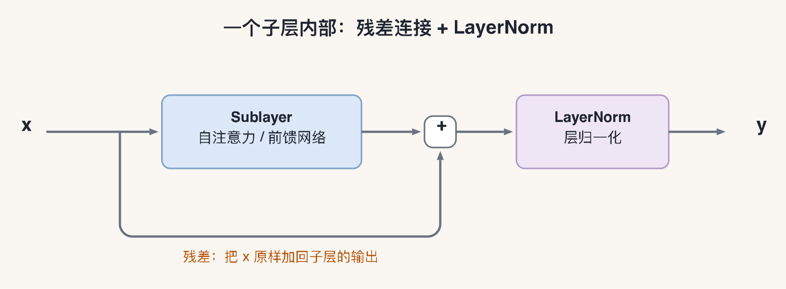
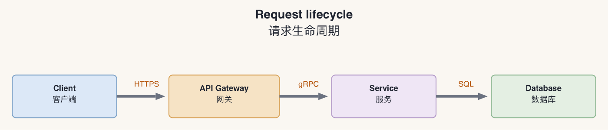

# picjs-skill

[English](README.md) | **中文**

一个面向 Agent 的 [picjs](https://github.com/pragdave/picjs) 技能包：把 picjs 的用法、官方文档快照、示例、渲染与更新脚本打包成可按需加载的 skill。

支持 `/picjs` 手动调用；picjs 运行时从 npm 在线安装到缓存，**不随仓库存储**。

> 本仓库不是 picjs 本身，而是它的 skill 封装 + 示例。
> picjs 的源码、文档、运行时都在上游：**<https://github.com/pragdave/picjs>**

## 原项目地址（picjs）

| 项目 | 地址 |
|---|---|
| picjs 源码 | <https://github.com/pragdave/picjs> |
| 文档 | <https://pragdave.github.io/picjs/> |
| Playground | <https://pragdave.github.io/picjs/editor/> |
| npm 包 | <https://www.npmjs.com/package/@pragdave/picjs> |
| 作者 | Dave Thomas |
| 许可证 | MIT（见 [`picjs-skill/LICENSE-picjs.md`](picjs-skill/LICENSE-picjs.md)） |
| 本仓库（skill 包） | `https://github.com/<your-name>/<repo-name>`（发布后替换） |

> 发布到 GitHub 后，把上面的 `<your-name>/<repo-name>` 换成实际仓库地址。

## 示例

| 示例 | 源文件 | 说明 |
|---|---|---|
| Transformer 整体结构 | [`transformer.picjs`](picjs-skill/examples/transformer/transformer.picjs) | 显式坐标、容器、双语居中、K/V 总线 |
| 注意力细节 | [`attention.picjs`](picjs-skill/examples/transformer/attention.picjs) | 垂直管道、多行居中标签 |
| 残差子层 | [`residual.picjs`](picjs-skill/examples/transformer/residual.picjs) | 残差 + LayerNorm |
| Request lifecycle | [`flow.picjs`](picjs-skill/examples/gallery/flow.picjs) | 浅色主题、显式配色 |
| Petal | [`petal.picjs`](picjs-skill/examples/upstream/petal.picjs) | 循环、弧线、颜色旋转 |

最小写法就是这样：

```picjs
box "Client" -> box "API Gateway" -> box "Service" -> box "Database"
```

### 1. Transformer 的逻辑结构

[](picjs-skill/examples/transformer/transformer.png)

[源码](picjs-skill/examples/transformer/transformer.picjs) · [三张图的中文讲解](picjs-skill/examples/transformer/notes.md)

<details>
<summary>展开：注意力细节与残差子层</summary>

[](picjs-skill/examples/transformer/attention.png)

[](picjs-skill/examples/transformer/residual.png)

</details>

### 2. 浅色流程图

[](picjs-skill/examples/gallery/flow.png)

[源码](picjs-skill/examples/gallery/flow.picjs)

### 3. Petal（循环 / 弧线 / 颜色）

<a href="picjs-skill/examples/gallery/petal.png"></a>

[源码](picjs-skill/examples/upstream/petal.picjs) · 更多示例见 [`examples/upstream/`](picjs-skill/examples/upstream/)

## 特点

- **按需加载**：`SKILL.md` 只是 170 行左右的入口，语法、布局、居中、渲染、坑位、更新分别放在 `docs/`，用哪块读哪块，避免一次撑爆上下文。
- **运行时在线安装**：`scripts/ensure-picjs.sh` 从 npm 安装 `@pragdave/picjs` 到 `${PICJS_HOME:-~/.cache/picjs-skill}`，仓库里没有 `node_modules`。
- **安装状态分支**：`ensure-picjs.sh --check` 已安装就直接用；未安装才走在线安装。
- **手动调用**：frontmatter 设置了 `disable-model-invocation: true`，不会被关键词自动触发；用 `/picjs` 或 `/` 菜单启动。
- **文档快照**：`references/` 保留官方 guide / language / layout / reference / animation / grammar，可用脚本一键刷新。

## 安装

需要 Node.js 18+（推荐 20+）。

```bash
git clone <your-repo-url> picjs-exp
cd picjs-exp

# 1) 安装 skill 到当前项目的技能目录（软链）
#    如果仓库里的 .dsh/skills/picjs 软链随 clone 保留，可跳过这一步
bash picjs-skill/scripts/install-skill.sh
# -> <project>/.dsh/skills/picjs

# 2) 在线安装 picjs 运行时到缓存
bash picjs-skill/scripts/ensure-picjs.sh
```

> `ensure-picjs.sh --check` 只检查不安装。  
> 如果 agent 沙箱不能写 `~/.cache`，先 `export PICJS_HOME=/tmp/picjs-skill`，再执行安装和渲染。

## 使用

重启会话（或重新加载 skills），在输入框输入：

```text
/picjs 帮我画一张 RAG 的流程图
```

也可以直接使用渲染脚本，不经过 skill：

```bash
cd picjs-skill

# SVG
node scripts/render.mjs examples/gallery/flow.picjs /tmp/flow.svg

# PNG（需要 rsvg-convert；macOS: brew install librsvg）
node scripts/render.mjs examples/gallery/flow.picjs /tmp/flow.png

# Markdown 里的 picjs 代码块（使用缓存里的 CLI）
bash scripts/picjs-cli.sh process README.md
```

## 目录

```text
.
├── README.md                     # English README（默认）
├── README.zh.md                  # 中文 README
├── LICENSE                       # 本仓库封装代码/文档的 MIT 许可证
├── .dsh/skills/picjs -> ../../picjs-skill
└── picjs-skill/
    ├── SKILL.md                  # 技能入口（安装检查 + 按需加载路由）
    ├── README.md                 # 技能包详细说明
    ├── package.json              # 只有脚本，无运行时依赖
    ├── docs/                     # 9 个按需加载的使用指南
    ├── references/               # 官方文档快照
    ├── examples/
    │   ├── transformer/          # Transformer 三张图 + PNG/SVG + notes.md
    │   ├── gallery/              # README 展示：flow + petal
    │   └── upstream/             # 官方 .picjs 示例
    └── scripts/
        ├── ensure-picjs.sh       # 在线安装/检查运行时
        ├── picjs-cli.sh          # 用缓存中的 CLI 处理 Markdown
        ├── render.mjs            # .picjs → SVG/PNG
        ├── update-from-upstream.sh
        └── install-skill.sh
```

## 更新

```bash
cd picjs-skill

# 看上游最新版本
npm view @pragdave/picjs version

# 改 scripts/ensure-picjs.sh 里的 PICJS_VERSION，然后安装/切换
bash scripts/ensure-picjs.sh

# 刷新文档快照 + 官方示例
bash scripts/update-from-upstream.sh
bash scripts/update-from-upstream.sh --check   # 只检查版本
```

更新策略、URL 列表和注意事项见 [`picjs-skill/docs/updating.md`](picjs-skill/docs/updating.md)。

## 许可证与致谢

- 本仓库的 skill 封装代码与文档：MIT，见 [`LICENSE`](LICENSE)。
- 上游 picjs 及其文档、示例：MIT，Copyright © Dave Thomas，见 [`picjs-skill/LICENSE-picjs.md`](picjs-skill/LICENSE-picjs.md)。
- picjs 原始项目：<https://github.com/pragdave/picjs>
